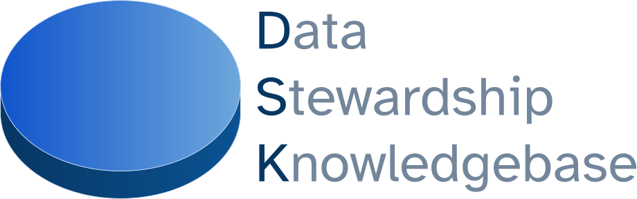

<p align="center">

<picture>
  <source media="(prefers-color-scheme: dark)" srcset="https://github.com/MrHedmad/data-stewardship-knowledgebase/blob/main/src/resources/images/dks_logo_light.png?raw=true">
  <source media="(prefers-color-scheme: light)" srcset="https://github.com/MrHedmad/data-stewardship-knowledgebase/blob/main/src/resources/images/dks_logo_dark.png?raw=true">
  
</picture>

</p>

<br>

> [!WARNING]
> The DSK is still under construction. Feel free to contribute to its development, but it is not ready for regular users.

## Welcome
Welcome to the Data Stewardship Knowledgebase Github repository!
These pages contain all the source code used to rebuild the DSK website.

If you're here to read the DSK, go to [dsk.hedmad.eu](https://dsk.hedmad.eu/) instead.
If you're here to contribute to the DSK, thank you!
Keep reading on to learn how to contribute, get recognition and more.

## What is this?
The Data Stewardship Knowledgebase attempts to act as a hub for Data stewardship knowledge scattered throughout the internet.

The idea for the DSK came from the Data Stewardship course held at the University of Torino in 2024 (see [here](https://hpc4ai.unito.it/cuap-data-steward/)).
Many resources relevant for data stewards are scattered around in the internet, and can be a bother to find.
Here, we gather all of them in an integrated, useful object.

The first draft links of the DSK were extracted from the slides that can be found in https://zenodo.org/records/11199741, originally from Dr. Elena Giglia (https://orcid.org/0000-0003-4927-2632).

## Running the book locally
The DSK is built with [MdBook](https://rust-lang.github.io/mdBook/).
To preview your changes on your machine, install the Rust toolchain and then the same tool versions used by the [deploy workflow](.github/workflows/deploy_book.yml):

```sh
cargo install mdbook --version 0.4.52 --locked
cargo install mdbook-callouts --version 0.2.2 --locked
cargo install mdbook-emojicodes --version 0.3.0 --locked
```

> [!NOTE]
> These versions are pinned on purpose: the book configuration and its preprocessors are not yet compatible with MdBook 0.5.

Then, from the root of the repository, run:

```sh
mdbook serve --open
```

The book is served at <http://localhost:3000> and reloads whenever you save a file.
Use `mdbook build` instead to only generate the static website into the `book/` directory.

For more details, including how to keep a different MdBook version installed alongside this one, see [CONTRIBUTING.md](CONTRIBUTING.md#building-the-dsk-locally).

# Contributing

This project is useless if it does not take into account everyone's opinions and contributions.
For a full guide on how to contribute, please see the [CONTRIBUTING.md](CONTRIBUTING.md) file.

> [!NOTE]
> A dump of all the links from prof. Giglia's slides can be found in [dump.md](dump.md). It's being gradually sorted into the respective sections.

## Roadmap
This section highlights the most salient milestones of the DSK:
- [ ] Define the scope of the DSK and its overall structure.
- [X] Create a core collection of resources important for Data Stewards.
- [ ] Label and sort the core collection into categories.
- [ ] Convert the DSK to a dedicated platform (e.g. a website) that is better suited for consumption.
- [ ] Start curating the resources through time with scheduled reviews and automatic link health checks.
